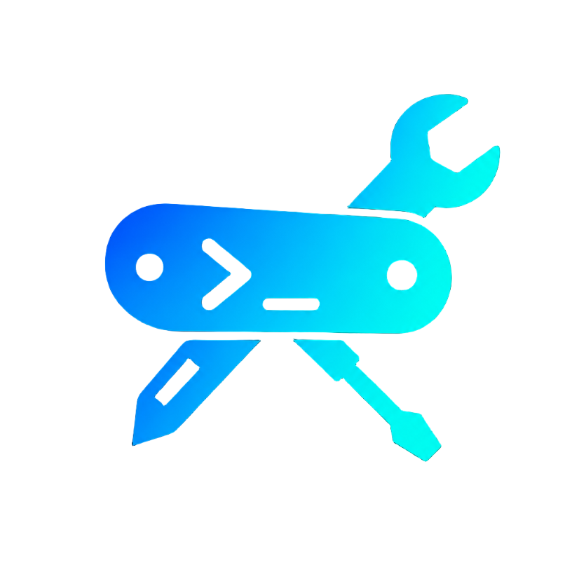

<p align="center">
  
</p>

<h1 align="center">ai-kit</h1>

<p align="center">
  <strong>Set up your AI coding assistant right — in 2 minutes</strong>
</p>

<p align="center">
  🌍 <strong>English</strong> |
  <a href="README.kk.md">Қазақша</a> |
  <a href="README.es.md">Español</a> |
  <a href="README.tr.md">Türkçe</a> |
  <a href="README.zh.md">中文</a> |
  <a href="README.ru.md">Русский</a>
</p>

<p align="center">
  <a href="https://www.npmjs.com/package/aidevkit"></a>
  <a href="https://www.npmjs.com/package/aidevkit"></a>
  <a href="https://github.com/hasabasa/ai-kit/blob/main/LICENSE"></a>
  
  
  
</p>

---

> ```
> ✦ ~45,562 tokens/req (ballast 2,590 · CLAUDE.md 42,088 · skills 884)
> ≈ $47.67/mo @ 150 req/day
> ```
> Real output from a real setup. That's what bloat costs you.

---

## What is ai-kit?

A **zero-dependency** Node CLI that:

1. **Scans** your machine — IDEs, AI extensions, CLIs, local & cloud LLMs, MCP servers, project stacks
2. **Surveys** you — ~10 arrow-key questions, most pre-filled from the scan
3. **Recommends** from a catalog of **20,669 tools** — with a one-line reason per tool
4. **Installs** with one confirmation — and disables the ballast that wastes your tokens
5. **Audits** an existing setup with `doctor` — tokens/request, $/month, bloated configs

Works with **Claude Code**, detects **Cursor**, **Gemini CLI**, **Codex**. Fully translated into **17 languages**.

<p align="center"></p>

## Quick Start

```bash
npx aidevkit
```

That's it. Or install globally:

```bash
npm i -g aidevkit
```

## Commands

| Command | What it does |
|---|---|
| `ai-kit` | Full flow: scan → survey → plan → install |
| `ai-kit scan` | Inventory only: IDEs, extensions, CLIs, LLMs, MCP servers, stacks |
| `ai-kit discover` | Browse 20k+ tools ranked for your stack + live GitHub search |
| `ai-kit doctor` | Audit: ballast plugins, bloated CLAUDE.md, tokens/req, $/month |
| `ai-kit doctor --fix` | Same + disable the ballast (asks first) |
| `ai-kit update` | Re-plan from saved profile, no survey |

## Flags

| Flag | Effect |
|---|---|
| `--dry-run` | Show plan, don't touch anything |
| `--yes` | No confirmation prompts |
| `--lang ru` | Skip language selection screen |
| `--no-open` | Don't auto-open the HTML report |
| `--json` | Machine-readable doctor output (for CI) |
| `--requests N` | Override default 150 req/day for cost estimate |

Full list: `npx aidevkit --help`

## How It Works

### 1. Scan

ai-kit scans your machine before asking anything:

- **IDEs**: VS Code, Cursor, Zed, Neovim, JetBrains, Xcode, Android Studio
- **AI tools**: Claude Code, Cursor, Gemini CLI, Codex, Cline, Windsurf, Copilot
- **Configs**: `.claude/`, MCP configs, CLAUDE.md, user skills, installed plugins
- **Project stacks**: from `package.json`, `requirements.txt`, `go.mod`, `Cargo.toml`, etc.
- **LLMs**: Ollama models, LM Studio, cloud API keys in env

### 2. Survey

~10 questions with arrow-key selection. Most answers are pre-filled from the scan:

- Role and experience level
- Languages and frameworks
- Databases and cloud services
- AI workflow: hand-coder or vibe-coder, hours/day
- What annoys you most about your current setup
- Every question has a free-text "your own" option

### 3. Plan

Each recommended tool comes with:
- A **one-line reason** why it fits
- A **"Why this fits you"** explanation tied to your answers
- **Conflict detection** — won't install two tools that fight each other

Ballast is flagged: business skill-packs (sales, legal, HR, finance…) that load into every request and give a developer nothing. Smart exceptions: if you do content work, marketing stays.

### 4. Install

One `y` installs everything. Tools install via their native commands (`claude mcp add`, `uv tool install`, etc.). Nothing runs without your explicit confirmation.

### 5. Doctor

```
✦ ~45,562 tokens/req (ballast 2,590 · CLAUDE.md 42,088 · skills 884)
≈ $47.67/mo @ 150 req/day

Ballast (loads every request, gives you nothing):
  ✗ sales-navigator         1,240 tokens
  ✗ legal-review             850 tokens
  ✗ hr-toolkit                500 tokens

Heavy configs:
  ⚠ ~/.claude/CLAUDE.md     42,088 tokens (consider slimming)
```

`doctor --fix` disables the ballast after showing what it will do. `--json` outputs machine-readable results for CI pipelines.

## Catalog

**20,669 tools** across categories:

- **MCP servers** — database connectors, API integrations, file tools, cloud services
- **Claude Code skills** — code review, testing, deployment, documentation
- **Cursor rules** — framework-specific, language-specific, workflow rules
- **Plugins** — linters, formatters, debuggers, profilers
- **CLI tools** — dev utilities installable via npm, pip, cargo, brew

The catalog updates with each release. Add your tool via PR — it's a plain JSON array.

## Supported Assistants

| Assistant | Scan | Install (auto) | Install (manual) | Doctor |
|---|:---:|:---:|:---:|:---:|
| Claude Code | ✅ | ✅ `claude mcp add` | ✅ | ✅ ballast + configs |
| Cursor | ✅ | ✅ writes `mcp.json` | ✅ | ✅ configs |
| Gemini CLI | ✅ | ✅ `gemini mcp add` | ✅ | ✅ configs |
| Antigravity | ✅ | ✅ writes `mcp_config.json` | ✅ | ✅ configs |
| Codex | ✅ | ✅ `codex mcp add` | ✅ | ✅ configs |
| Windsurf | ✅ | ✅ writes `mcp_config.json` | ✅ | ✅ configs |
| Cline | ✅ | ✅ writes `mcp_settings.json` | ✅ | ✅ configs |

## Languages

Interface translated into 17 languages:

🇺🇸 English · 🇷🇺 Русский · 🇰🇿 Қазақша · 🇪🇸 Español · 🇧🇷 Português · 🇫🇷 Français · 🇩🇪 Deutsch · 🇹🇷 Türkçe · 🇮🇩 Bahasa · 🇵🇱 Polski · 🇨🇳 中文 · 🇯🇵 日本語 · 🇰🇷 한국어 · 🇮🇳 हिन्दी · 🇸🇦 العربية · 🇺🇿 O'zbek · 🇦🇱 Shqip

Use `--lang <code>` to skip the language selection screen.

## Safety

- Nothing is installed or disabled without your explicit `y`
- `doctor` numbers are honest estimates (labeled as such), not fake precision
- No telemetry. No network calls of its own — it only shells out to `claude`, `uv`, etc.
- Zero dependencies — Node stdlib only, nothing to audit

## Contributing

The catalog is a plain array in `cli.mjs` (`CATALOG`): `id`, `why` (i18n key), `tags`, `install[]`.

1. Add your tool to `CATALOG`
2. Add one-liner translations to the `UI` locales
3. Run `node cli.mjs --test`
4. Send a PR

## Roadmap

- [ ] Full install adapters: Cursor, Gemini CLI, Codex CLI, Cline, Windsurf
- [ ] Windows installers (winget/scoop paths)
- [ ] Community catalog repo (add tools via PR)
- [ ] `doctor`: CLAUDE.md slimming suggestions, more conflict rules
- [ ] More full translations

## License

[MIT](LICENSE) © [hasabasa](https://github.com/hasabasa)
